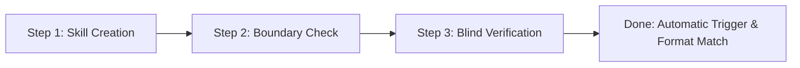

# Project 1: Weekly Study Notes AI Skill

An implementation of the **Market-of-One** AI skill pattern using Antigravity / Agentic Workflows.

## Pipeline Architecture



## Directory Structure
```text
.agents/skills/weekly-study-notes/
├── SKILL.md                 # Primary skill definition and trigger description
└── examples/
    └── sample-notes.md      # Ground truth sample input & expected output format
```

## The 3-Step Execution Loop

### 1. Skill Creation
The skill definition is stored in [`.agents/skills/weekly-study-notes/SKILL.md`](file:///.agents/skills/weekly-study-notes/SKILL.md). It enforces:
- Topic headings
- Short, bold key-terms list
- Exactly three review questions at the end

### 2. Boundary Check
Ensure the skill triggers only on study/class note requests and stays dormant for unrelated queries:
- **Triggers**: "Make study notes from this", "Format my weekly lecture notes", "Synthesize this class material".
- **Does Not Trigger**: "Write an email to my professor", "Summarize this news article", "Fix my Python script".

### 3. Blind Verification
Run a test with unformatted raw notes without naming the skill. Verify that:
1. The skill activates automatically.
2. The format strictly adheres to the 3-part layout.
3. The review question count is exactly 3.
